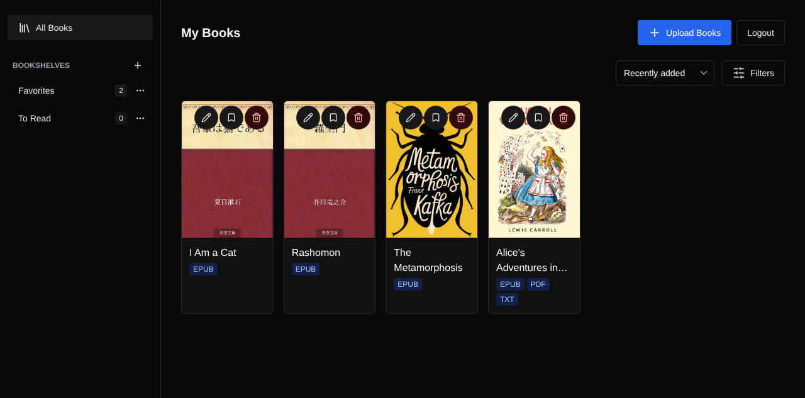
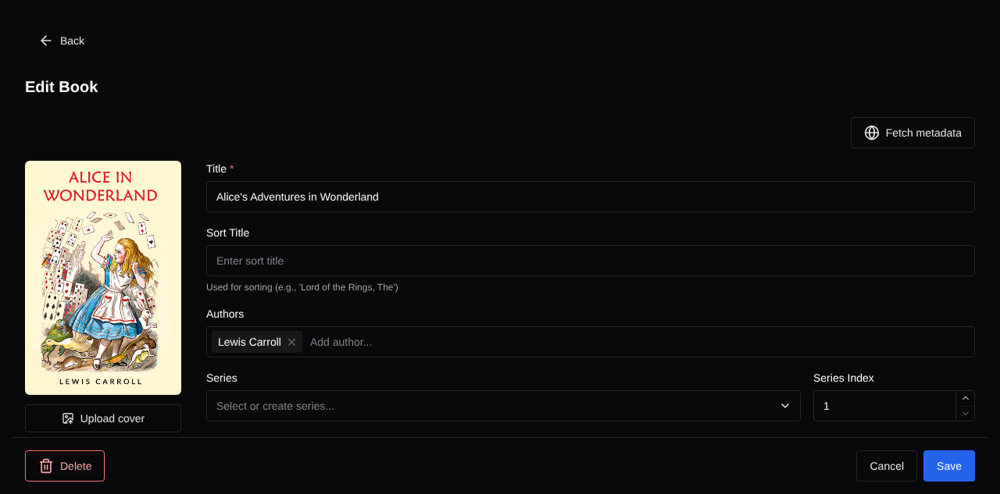
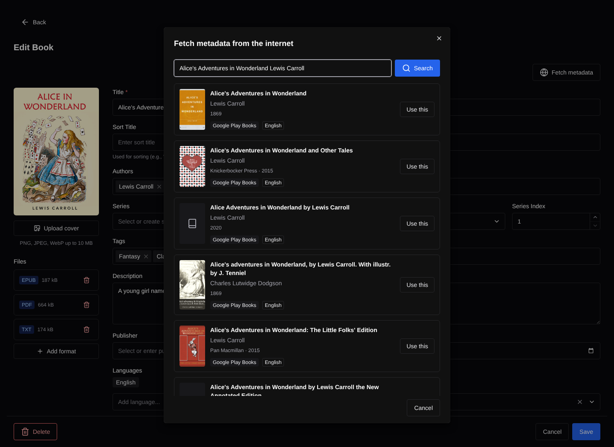
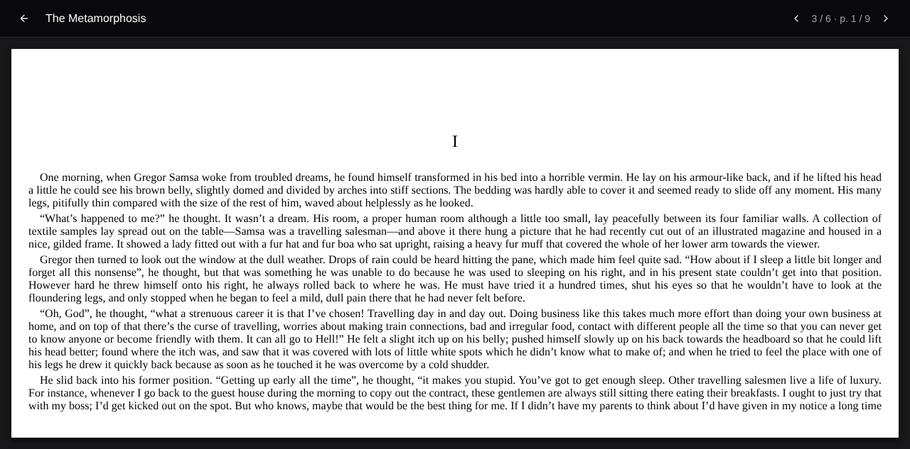

# Calibre-Web Serverless

> [!WARNING]
> This project is under active development and many features are not yet implemented.

A modern, serverless reimplementation of [Calibre-Web](https://github.com/janeczku/calibre-web) built with Next.js and TypeScript.

## Screenshots









## Why Not Calibre-Web?

Calibre-Web does the job well. This project exists because of what running it costs and demands, not because of what it does:

- **The stack has aged** — Python/Flask with server-rendered templates and a jQuery-era frontend, and no static typing to lean on. Reading the code and changing it safely costs more than it should.
- **You pay for an instance around the clock** — tending a library takes a few minutes at a time: upload a book, correct its metadata, send a file to a reader. Because it is not serverless, the instance has to stay up and billing through all the hours in between.
- **TLS on a single instance is awkward** — for one long-lived instance, the major cloud providers offer few managed certificate options. You end up either paying for a load balancer to sit in front of it or renewing certificates yourself.
- **The library sits on ephemeral storage** — a Calibre library on an instance disk has no redundancy and needs a backup story of its own. Pointing it at NFS makes it durable but slow, and a grid of cover images makes that latency impossible to miss.

## Why This Project?

Reading happens on a dedicated e-reader; the web app is only needed for those brief moments in between. A serverless architecture fits that shape:

- **Reduce costs** — Pay only for actual usage, not idle time
- **Ensure reliability** — Leverage managed services (Firebase) for affordable, redundant storage
- **Improve maintainability** — Use static typing with TypeScript for safer code, and leverage a modern tech stack to minimize codebase size
- **Provide a refined UI** — Deliver a modern, polished user experience

## Goals

Achieve feature parity with Calibre-Web while embracing serverless principles and modern web technologies.

## Tech Stack

- **Framework**: Next.js (App Router), React
- **UI**: Chakra UI, Emotion
- **Forms**: react-hook-form
- **Backend**: Firebase (Auth, Firestore, Storage)
- **Language**: TypeScript
- **Testing**: Vitest, Playwright, Storybook
- **Linting/Formatting**: Biome

## Setup

### Prerequisites

- [Nix](https://nixos.org/download/) with flakes and [direnv](https://direnv.net/): `direnv allow` enters the devshell — bun, a headless JDK for the Firebase emulators, and Chromium for the E2E tests — and loads the development environment variables.
- Without Nix, install those yourself: bun, a JDK (the Firestore and Storage emulators run on Java), and Chromium for `bun run test:e2e`.

### Local development

```bash
direnv allow   # or: nix develop
bun install
bun run dev
```

`bun run dev` bundles the Cloud Functions, starts the Firebase emulators, seeds them, and serves the app on <http://localhost:3000>. Nothing talks to a real Firebase project, so no account or credentials are needed. Sign in as `test@example.com` / `password123`; [docs/seeding.md](docs/seeding.md) covers the rest of the seeded library.

### Stabilizing the metadata search locally

The "fetch metadata from the internet" feature calls the Google Books API. Without an API key it falls back to the public, IP-rate-limited quota and quickly returns `429`, which makes local verification flaky. For stable local testing, set a Google Books API key in `.envrc.local` (gitignored):

```bash
# .envrc.local
export GOOGLE_BOOKS_API_KEY=your-google-books-api-key
```

`.envrc` sources `.envrc.local` automatically — run `direnv allow` after creating it. The key is only needed locally; deployed environments read it from Secret Manager.

### Deploying

Everything the deployed environments need is Terraform (`terraform/`): the Firebase projects, Firestore, Cloud Storage, Identity Platform, App Check, the functions' IAM and secrets, and the Workload Identity Federation that the GitHub Actions deploy authenticates with. The staging and production project IDs are declared in `terraform/main.tf`.

1. Copy `terraform/terraform.tfvars.example` to `terraform.tfvars` and fill it in.
2. Run `terraform apply`. It generates `web/.env.staging` and `web/.env.production`, and outputs the Workload Identity provider and the deploy service account.
3. Set those as the `WIF_PROVIDER`, `FIREBASE_SERVICE_ACCOUNT` and `FIREBASE_PROJECT_ID` variables of the matching GitHub environment, then run the Deploy workflow.

App Check enforcement has to follow the client that carries its site key, or the deployed app locks itself out — see [docs/security.md](docs/security.md).

## Roadmap

Shipped:

- [x] Authentication, with password reset
- [x] Library dashboard
- [x] Book upload — several files at once, in a background queue that survives in-app navigation and resumes uploads interrupted mid-transfer
- [x] Multiple file formats per book (EPUB, PDF, MOBI, AZW, AZW3, FB2, TXT)
- [x] Auto-extract metadata from uploaded books (EPUB, PDF)
- [x] Book metadata editor
- [x] Book cover management, including custom cover upload
- [x] Book deletion
- [x] Filter and sort the library by author, series, publisher, tag, language and rating
- [x] Bookshelves (user-created collections)
- [x] Fetch metadata from external sources by title or identifier
- [x] OPDS catalog, authenticated, with per-bookshelf feeds
- [x] Built-in reader for PDF and EPUB, including vertical writing

Planned:

- [ ] Book detail page
- [ ] Book search
- [ ] Reading progress tracking
- [ ] Send-to-Kindle
- [ ] NotebookLM integration
- [ ] ML-based metadata extraction from cover images (fallback)
- [ ] Social login
- [ ] Two-factor authentication
- [ ] Passkey support
